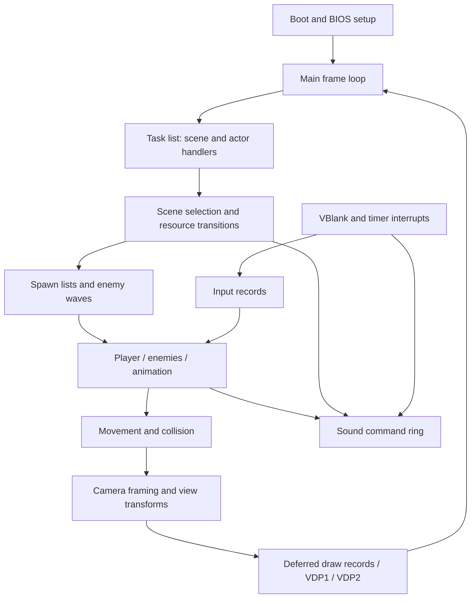

# Following Die Hard Arcade through the functional C tree

Start with [game_boot_and_run](../project/src_functional/02201020.c). Its frame loop is the spine of the game. Follow task handlers to find gameplay, then follow the matrix and display queues to find what reaches the screen. This is a map of the recovered C model, including its remaining gaps; it is not a claim that every branch is understood or verified.

Files retain their address names so you can move between C, disassembly and ROM notes. Search function names with `rg` in `project/src_functional`. [dh_names.h](../project/src_functional/dh_names.h) maps semantic source spellings back to their original linker symbols. [symbols.txt](symbols.txt) records addresses, confidence and evidence. An `_entry` or `_raw_entry` alias preserves an existing raw extern that was distinct from a descriptive definition; those spellings were deliberately not merged. Pass 4 also uses `_source_alias` for preserved duplicate C spellings/drafts and `_interior` for unqualified event targets. These suffixes describe source identity or evidence limits; they do not make two prototypes interchangeable.

For common mods, start here and then follow the named calls:

| Change | Where to look |
|---|---|
| Health and damage | [actor_apply_damage](../project/src_functional/0222ab18.c), [actor_hit_countdown](../project/src_functional/0222ac60.c); actor `health` at `+56`. |
| Enemy attack distance and choice | [enemy_select_latched_attack](../project/src_functional/02244e54.c), [enemy_choose_action_and_side](../project/src_functional/02245632.c); actor `distance_attack_table`, `queued_attack_kind/slot`. |
| Grab/throw behavior | [player_handle_grab_throw_commands](../project/src_functional/0222c39c.c), [enemy_tick_grab_throw](../project/src_functional/02243066.c), [enemy_tick_grabbed_overlay](../project/src_functional/022433e8.c). |
| Input prompts and acceptance | [prompt_tick_random_accept](../project/src_functional/02219c44.c), [prompt_tick_rotating_buttons](../project/src_functional/02219f26.c); three proven action bits, no assumed button labels. |
| Camera range and tracking | [camera_track_two_slots_task](../project/src_functional/0220c3e0.c), [camera_update_player_follow](../project/src_functional/0220cfac.c); camera `horizontal_range` and framing targets. |
| Encounter timing and spawn branches | [scene_tick_branch_drain](../project/src_functional/0221b8e4.c), [setpiece_director](../project/src_functional/0221bf72.c), [boss_intro_director](../project/src_functional/0221c690.c); `DhSceneSequenceWork`. |
| Models and individual mesh parts | [model_load_scene_records](../project/src_functional/02223ac0.c), [model_emit_mesh_part](../project/src_functional/02235dc0.c); `DhModelDefinition` and the model-ID map. |
| Sound timing and cue selection | [sound_tick_timeline_cues](../project/src_functional/0221ad06.c), [camera_tick_sound_timeline](../project/src_functional/022203ce.c), [sound_step_command_cursor](../project/src_functional/0223845c.c). |
| Results and options screens | [results_task_dispatch](../project/src_functional/02209188.c), [results_edit_options](../project/src_functional/02209a8c.c), [results_draw_final_stats](../project/src_functional/02209d70.c). |

## Boot: hardware, resident services and the first tasks

[game_boot_and_run](../project/src_functional/02201020.c) calls `game_reset_globals`, resets input, installs interrupt callbacks through BIOS function-pointer slots, configures SCU timing, initializes audio and render buffers, and creates the root task list. `smpc_stop_slave_cpu` / `smpc_start_slave_cpu` bracket setup of the second CPU. The boot code installs a resident entry at runtime address `0x060051b0`; that entry itself has no C translation unit here. The display stage functions below describe the recovered command-processing side.

[game_reset_globals](../project/src_functional/02201958.c) reads the resident BIOS configuration into `g_bios_status_buffer`. Language, panel configuration and session mode influence later branches. Calls through `0x060006xx` slots are resident services, not ordinary game functions to replace with empty callbacks.

[boot_display_mode_task](../project/src_functional/02201590.c) allocates startup work and installs [boot_scene_director_task](../project/src_functional/022016ac.c). That task sequences boot/attract/display states. [scene_bootstrap](../project/src_functional/022058a8.c) selects the scene step callback, creates the descriptor pointer and installs the attract controller.

For a startup mod, trace the selected handler and its state byte first. A task often changes its own handler instead of returning an enum to a central switch.

## The main frame loop and interrupt timing

The endless block in [game_boot_and_run](../project/src_functional/02201020.c) resets per-frame counters, resets collision lists, clears pair scratch, publishes render buffer cursors and waits on the shared display-ready flag. It then runs, in order:

1. [task_run_frame](../project/src_functional/0220fde4.c): scene, actor, effect and HUD callbacks.
2. [collision_sweep_grid](../project/src_functional/0222ece4.c): combat collision processing.
3. [display_commit_channel_accumulator](../project/src_functional/022386c6.c): accumulated display colour/channel changes.
4. [view_build_display_transform](../project/src_functional/022225f6.c), for both views, then [displist_priority_fill](../project/src_functional/022227c4.c).
5. Shared-ready waits and [frame_measure_pulse_timing](../project/src_functional/02223c74.c) before the next iteration.

The separate command stream at `0x060e0bd0`, with cursors at `0x060e0dd0/4`, coordinates display stages. It is different from the sound ring. The functions `display_stage_clear_work`, `display_stage_clear_sprite_tables`, `display_stage_clear_sprite_scratch`, `display_stage_reset_sort`, `display_stage_reset_cursors`, `display_stage_build_quads` and [display_stage_submit_frame](../project/src_functional/0220134c.c) are entries in the recovered stage table, not direct calls from the gameplay loop. The last stage sorts records, rebuilds proximity tables and uploads VDP1 command lists.

[isr_vblank_in](../project/src_functional/02223cf0.c) handles frame-change setup, resident callbacks and input sampling. [isr_vblank_out](../project/src_functional/02223d98.c) advances the interrupt frame count and commits framebuffer mode. [isr_timer0](../project/src_functional/02223dca.c) cycles display pages, updates colour control and calls the sound queue consumer. `g_frame_tick` and the VBlank pacing counter are different globals; preserve that distinction when changing timers.

## Scenes: attract, joining and resource transitions

The game task's controller chain is visible in these files:

| Controller | What to follow |
|---|---|
| [attract_update_task](../project/src_functional/02204868.c) | Services credit/join edges, steps the selected scene and chooses a round controller. |
| [attract_service_credit_join](../project/src_functional/022045f8.c) | Consumes coin/join edges and updates resident/player readiness state. |
| [round_join_countdown_task](../project/src_functional/02204afa.c) | Credit-present join countdowns and controller handoff. |
| [round_dual_countdown_task](../project/src_functional/02205232.c) | Both-player/free-play countdown route into live play. |
| [game_run_scene_step](../project/src_functional/02205812.c) | Calls the current scene step callback. |
| [scene_advance_task](../project/src_functional/02205b20.c) | Selects the next descriptor and spawns its handler when the child completion bit is raised. |

`g_scene_index` selects a **0x50-byte descriptor** in the table at `0x06072660`; `g_scene_descriptor` points at it. The recovered `DhSceneDescriptor` in [dh_work.h](../project/src_functional/dh_work.h) names resource-list pointers at `+00/+04/+08`, optional sound resource at `+0c`, camera definition at `+10`, stage-grid index at `+20`, view radius at `+24`, and the overlapping pose/angle selectors at `+28/+29`. The task handler is read at `+14`; the enemy wave script is read at `+18`. Those last two remain raw fields pending broader layout evidence. The transition selector at `+2b` and following next-index bytes drive the director's branches.

`DH_SCENE_SELECTOR` is index 0; its [scene_select_index_task](../project/src_functional/02205c96.c) scrolls the index and defaults to `DH_SCENE_PLAY_ENTRY` (2). `DH_SCENE_STOP` (81) is the director stop case. Its descriptor also has the existing [scene81_game_sm](../project/src_functional/02206876.c) resource/start/fade controller: the director's stop test and that handler's local states are different decisions. Avoid interpreting every occurrence of 81, or a historical “GAME scene” comment, as the ordinary gameplay frame loop. `DH_SCENE_NONPLAY_FIRST` (76) is the threshold where the director resets join state. Index 52 has a proven saved-action restore bypass; its constant describes that behavior, not an invented level title.

[scene_run_task](../project/src_functional/02202e84.c), [scene_bootstrap_task](../project/src_functional/022027e4.c) and [scene_record_bootstrap_task](../project/src_functional/02218038.c) are scene-local state machines. Graphics swaps go through [scene_reload_graphics](../project/src_functional/02217d6c.c); stage reset goes through [scene_reset_stage](../project/src_functional/02217f04.c). The latter invokes stage-grid and background setup. [scene_spawn_display_and_effects](../project/src_functional/02233250.c) ties together backgrounds, HUD tasks and scene effect lists.

For a scene-order mod, inspect the descriptor transition bytes and director together. For a background/resource mod, follow the three resource-list comparisons and their loaders. A descriptor change can affect camera selection, spawn tables and display setup at once.

## Tasks and actors: who owns the update

[task_pool_reset](../project/src_functional/0220fc18.c) creates a pool of 511 task nodes. `DhTaskRecord` has handler `+00`, next `+04`, work `+08`, depth `+0e`, local state `+10` and parent `+14`. [task_run_frame](../project/src_functional/0220fde4.c) walks the list, calls live handlers and reclaims canceled nodes and owned allocations. Clearing a handler cancels a task; [task_cancel_below_depth](../project/src_functional/0220fdc8.c) cancels descendants by depth.

The spawner names show list insertion policy and work size. `task_spawn_child_work88`, `task_spawn_current_work6c`, `task_spawn_list_work7c`, `task_spawn_child_work40`, `task_spawn_current_work40` and `task_spawn_current_workdc` are different constructors. [task_spawn_actor_work](../project/src_functional/0220ff0a.c) allocates **0x18c bytes**. It does not make every other work allocation an actor.

[heap_allocate_owned](../project/src_functional/02214b70.c), [task_alloc_zeroed_array](../project/src_functional/02214bb8.c) and [heap_free_coalesce](../project/src_functional/02214c8a.c) explain allocation ownership. Task `+08` also serves as the owned-allocation chain during cleanup. Retain the existing task pointer accessors when examining that machinery.

The actor registry has eight slots: player slots are 1/2; dynamic registration starts at 3. [actor_spawn_fixed_slot](../project/src_functional/02227bc4.c) and [actor_spawn_dynamic_slot](../project/src_functional/02227b60.c) publish slot IDs and task pointers. [actor_reset_slot_registry](../project/src_functional/02227a84.c) clears occupancy and the relation matrix. [actor_build_proximity_tables](../project/src_functional/02227ca8.c) rebuilds actor/actor and actor/effect distance tables used by camera and combat decisions.

There are several spawn formats. [process_spawn_list](../project/src_functional/0222a5d0.c) consumes **24-byte actor records**. [scene_spawn_record_list](../project/src_functional/02233388.c) consumes **20-byte generic task records**. [scene_spawn_effect_list](../project/src_functional/022332d4.c) consumes **8-byte effect records**. Do not change their strides as if they were one format.

## Player, enemies, animation and combat

[actor_update_task](../project/src_functional/0222863e.c) dispatches `g_actor_state_handlers` using the actor's byte `state_handler`, then handles hit shake, drawing, grid registration and HUD counters. [player_update_combat_input](../project/src_functional/02223ee0.c) translates input into action category/state changes. [player_select_motion_animation](../project/src_functional/0222b7e8.c) selects animation/continuation from those motion flags. [player_try_special_move](../project/src_functional/0222c220.c) holds the explicit three-action-button chord and its eligibility gates.

Actor state has several layers; follow the relevant one instead of treating all state fields as interchangeable:

| Actor field | Role and key reader |
|---|---|
| `state_handler` `+43` | Player/actor update-handler table, `actor_update_task`. |
| `action_category/action_state` `+84/+88` | Movement/combat classification, `player_update_combat_input`. |
| `interaction_flags` `+8c` | Effect/action links and interaction masks, `actor_select_effect_action`. |
| `behavior_state/behavior_phase` `+d4/+d8` | Enemy task behavior and its local phase, `enemy_update_state_task`. |
| `state_flags/state_index` `+e0/+e4` | Enemy dispatch controls and descriptor family, `actor_state_dispatch`. |
| `action_phase` `+108` | Second-level action handler selector, `actor_dispatch_action_and_finish`. |

Enemy wave scripts enter through [enemy_wave_initialize_task](../project/src_functional/02246308.c) and [enemy_wave_spawn_task](../project/src_functional/022463b8.c). [enemy_initialize_spawn_task](../project/src_functional/02246678.c) loads art, movement, action and script data and installs the per-type task handler. [enemy_update_state_task](../project/src_functional/022469a0.c) and the category-specific task drivers dispatch behavior, draw the actor and insert it into the collision grid.

For AI changes, start with [enemy_reset_idle_or_walk](../project/src_functional/022469f2.c), [enemy_begin_approach](../project/src_functional/02246cac.c), [enemy_sweep_toward_target](../project/src_functional/02243fe0.c) and [enemy_choose_engagement](../project/src_functional/02247e14.c). Concrete behaviors include [enemy_update_dash](../project/src_functional/022475a8.c), [enemy_update_turn](../project/src_functional/02248436.c), [enemy_update_grapple](../project/src_functional/022485b8.c), [enemy_update_carry_throw](../project/src_functional/0224886e.c) and [enemy_update_combo](../project/src_functional/022492f8.c). Names describe recovered roles; they do not assign unproven enemy species to numeric type IDs.

[enemy_load_action_descriptor](../project/src_functional/02245c88.c) selects a descriptor by state family and variant and copies it into the actor tail. The independently agreed animation words at actor `+148/+14a/+14c/+14e` are now `idle_animation`, `approach_animation`, `state2_animation` and `state8_animation`. Those table-driven IDs are usually the better animation mod point than replacing an arbitrary literal. The few named fixed animation IDs identify their observed combo/wait/held-command roles; `DH_ANIMATION_ABSENT` is the optional-table sentinel.

[actor_anim_frame_update](../project/src_functional/0222dc2c.c) advances interpolation, uses the current/requested animation IDs, updates pose buffers and root motion, and fires frame events. [actor_load_pose_buffers](../project/src_functional/0222db44.c) and [actor_load_current_pose_buffers](../project/src_functional/0222da90.c) seed those buffers. [actor_resolve_facing](../project/src_functional/02227704.c) updates cardinal facing from the slot pose. [actor_enter_hit_reaction](../project/src_functional/022489d0.c) initializes a reaction; [actor_dispatch_pose_and_type](../project/src_functional/0222adaa.c) runs the pose-set and type callbacks.

Movement and combat collision are connected but have distinct grids. [actor_resolve_movement](../project/src_functional/022170ea.c) selects an overlap policy and calls [collision_resolve_sweep](../project/src_functional/0221746c.c) against movement records registered by [actor_register_movement_slot](../project/src_functional/0221707c.c). Its `grid_find_overlap_any/static/type_zero` callbacks scan neighbouring AABBs. Combat's [collision_queue_actor](../project/src_functional/0222eea2.c), [collision_insert_grid](../project/src_functional/0222eee4.c) and [collision_sweep_grid](../project/src_functional/0222ece4.c) feed [collision_test_pose_hitboxes](../project/src_functional/0222ef38.c) and [collision_test_swept_hitbox](../project/src_functional/0222f1d0.c). Changing movement extents and changing attack hitboxes are separate edits.

Pooled effect actors have their own eight-slot registry. [effect_pool_spawn](../project/src_functional/0223cbb0.c), [effect_pool_update_pose](../project/src_functional/0223a924.c) and [effect_pool_release](../project/src_functional/0223cd0c.c) manage it. Actor `primary_effect_type/slot` and `secondary_effect_type/slot` bytes identify the two attachment channels. [actor_commit_effect_handoffs](../project/src_functional/0223a9d0.c) consumes pending handoffs. The two `DH_EFFECT_TYPE_LIMITED_*` IDs have proven tighter capacity gates; their visual identities remain unnamed.

## Local enemy decisions and scene clocks

[enemy_select_latched_attack](../project/src_functional/02244e54.c), [enemy_try_latched_attack](../project/src_functional/0224519e.c) and [enemy_select_mode_attack](../project/src_functional/02244fdc.c) share a decision chain: validate a live target, check lock flags, measure X separation, consult the actor's `distance_attack_table`, then apply timing, facing and collision gates. They write `queued_attack_kind` (`+100`) and sometimes `queued_attack_slot` (`+104`); their return codes are separate from the chosen kind. Changing a return code alone does not replace the queued move.

[enemy_choose_and_start_motion](../project/src_functional/022454e4.c) asks [enemy_choose_action_and_side](../project/src_functional/02245632.c) for two output words, then indexes `motion_action_tables` and calls `actor_init_from_cfg`. The config tables copied by [enemy_load_action_descriptor](../project/src_functional/02245c88.c) also include direction animations, reactions and response lists. Their guest pointer fields stay four bytes in the layout; the original `MP` accessors keep the functional tree's native-pointer semantics. The source descriptor's last pointer order differs from the actor tail: `+184` is copied before `+180`. Edit the intended table rather than flattening that order.

`health` (`+56`) is established by spawn seeding, damage subtraction/clamping and zero-health transition consumers. Some historical comments call it a hit timer or readiness word. `hit_source_slot`, `paired_slot` and `action_pending` are separate byte fields. Saved primary effect type/slot (`+6a/+6b`) and pending handoff/slot (`+70/+71`) are separate from live effect type/slot (`+6c..+6f`); channel swaps move values among them.

The timed scene handlers now share `DhSceneSequenceWork`: `main_ticks` (`+18`), `phase_ticks` (`+1c`), `spawn_cursor` (`+30`) and saved `branch_cursor` (`+3c`). This is a prefix for the inspected list interpreters, not actor work. `process_spawn_list` advances 24-byte entries and writes the cursor back. Some sequences count upward, and several deliberately fall through into another state on the same frame. The scene clock, the task state byte, actor animation frame and enemy behavior phase are independent.

[scene_tick_waypoint_model_intro](../project/src_functional/0221f9c4.c) selects the segmented-model path only for scene index 13, then changes to a model-list draw after its delay. `DH_SCENE_SEGMENTED_MODEL_INTRO` names that observed branch, not a stage title. The `_draft` event handlers [event_spawn_sequence_draft](../project/src_functional/0221cfa4.c), [event_spawn_dispatch_draft](../project/src_functional/0221ec08.c) and [event_gate_branch_draft](../project/src_functional/0221edec.c) retain the v1.09 implementation/ABI gaps. Their descriptive names do not promote them to verified implementations.

## Camera and rendering: world pose to VDP1/VDP2

`g_view_task` owns the active view work. [camera_pose_init_task](../project/src_functional/0220b1c0.c) and [camera_init_pose](../project/src_functional/0220bc20.c) seed position and angles from scene tables and add the stage origin. The near/medium/far framing handlers derive bounds using [view_bounds_from_actors](../project/src_functional/0220d9ec.c). Their approach partners ease into the corresponding steady handler. [camera_ease_to_target](../project/src_functional/0220e0aa.c) caps eye/angular steps; [camera_tick_shake](../project/src_functional/0220d98e.c) adds the timed vertical shake.

`DhCameraWork` names the world pose, stage origin, focus, orbit offsets, request/shake timers and target position/angles. It describes the prefix through `+c9`, padded to `0xcc`; it is not a guessed full allocation size. `update_handler` (`+64`) is installed by framing/approach handlers and invoked through the task trampoline. `horizontal_range` (`+68`) bounds X around the stage origin in tracking handlers. `+ae` is a target slot in orbit tracking and a countdown in camera-definition stepping, so it remains reserved in this common layout. [camera_update_slot_orbit](../project/src_functional/0220cdf6.c) and [camera_update_player_follow](../project/src_functional/0220cfac.c) are useful zoom/orbit mod points. [debug_free_fly_camera](../project/src_functional/0220f5b8.c) exposes the recovered debug controls.

[mtx_build_fwd_inv](../project/src_functional/02214a7a.c) caches model/view matrices. `matrix_translate_current`, `matrix_scale_columns`, `mtx_rotate_zyx_at24` and `matrix_transform_to_scratch` operate on the active matrix stack. One stack frame is 48 bytes. [view_build_display_transform](../project/src_functional/022225f6.c) builds the display transforms from the view pose; [vertex_transform_project](../project/src_functional/022135a0.c) transforms and projects model vertices. Existing descriptive aliases may use the same address with a distinct C linker spelling.

VDP1 draws the submitted sprites and polygons. Follow [model_submit_culled](../project/src_functional/02215a2c.c), [sprite_draw_child](../project/src_functional/022153f6.c), [sprite_draw_billboard](../project/src_functional/022154fc.c), [draw_actor_hier_shadowed](../project/src_functional/0222ca98.c) and [actor_draw_skeletal_mesh](../project/src_functional/0222d450.c). [vdp1_build_sprite_commands](../project/src_functional/022156da.c) and its [reverse-buffer sibling](../project/src_functional/0221582a.c) turn deferred records into command storage. [display_radix_sort_records](../project/src_functional/02214e2c.c) and [display_radix_sort_entities](../project/src_functional/02214e2e.c) sort depth keys; they are not DMA wait loops.

`DhModelDefinition` describes the shared **0x14-byte** ROM/runtime model record: byte vertex and quad counts at `+00/+01`, vertex/quad guest pointer words at `+04/+08`, and draw-handler index at `+10`. [model_load_scene_records](../project/src_functional/02223ac0.c) copies sixteen-byte vertex/quad records into separate arenas and fills the ID-to-record map. [model_build_quad_list](../project/src_functional/02215cb4.c), [model_build_pending_quad_list](../project/src_functional/02215bf4.c) and [model_emit_mesh_part](../project/src_functional/02235dc0.c) agree on the fields. A model ID at work `+30` is mapped through `0x0609ebd0` before indexing this table; it is not already a runtime record index. Handler index is ORed with the submission mode before the dispatch.

Keep these render formats separate:

| Type | Stride | Meaning |
|---|---:|---|
| `DhSpriteCharacter` | `0x10` | Texture address/size, dimensions and draw mode. |
| `DhSpriteDrawRecord` | `0x30` | Deferred vertices, depth, descriptor and mode bits; depth `-1` ends the list. |
| `DhVdp1CommandEntry` | `0x24` | A `0x20`-byte hardware packet plus the software sort key at `+20`. |

[vdp1_upload_command_lists](../project/src_functional/02214f90.c) builds the transfer descriptors. [vdp1_begin_frame](../project/src_functional/02214cdc.c), [vdp1_trigger_draw](../project/src_functional/02214d26.c) and [vdp1_append_frame_headers](../project/src_functional/02215000.c) control drawing, erase/clip regions and frame command headers. Packed vertex words retain the original byte order; changing a host struct's interpretation is not a coordinate conversion.

VDP2 holds background layers, scroll/zoom, colour and text. [scene81_stage_setup](../project/src_functional/02206e2e.c) and [scene_bg_layer_build](../project/src_functional/02207360.c) load background assets. `vdp2_apply_layer0_commands`, `vdp2_apply_layer1_commands`, `vdp2_apply_text_layer_commands` and `vdp2_apply_rotation_commands` interpret command/value streams into `g_vdp2_register_shadow`. [vdp2_queue_attribute](../project/src_functional/0221632e.c) registers changing attributes. The tilemap copy/fill functions handle page seams; replacing them with a flat rectangular copy would change wrapping.

HUD text uses [hud_setup_small_font](../project/src_functional/02222d3c.c), [hud_setup_large_font](../project/src_functional/02222e44.c), [text_write_small](../project/src_functional/02222fe0.c) and [text_write_large](../project/src_functional/02223080.c). `g_ui_cursor_column` and `g_ui_cursor_row` are coordinates despite some historical colour/mode guesses in older comments. [hud_update_player_meters](../project/src_functional/02237828.c), [hud_draw_segmented_meter](../project/src_functional/02237be4.c) and [hud_update_player_counters](../project/src_functional/0223df30.c) are the gauge and inventory/counter routes.

## Sound: queueing a request is separate from transporting data

[audio_load_driver](../project/src_functional/02215da8.c) loads the sound driver and initializes SCSP control. [audio_send_command_buffer](../project/src_functional/02215e20.c) performs mailbox handshaking and a bounded data transfer, including timeout recovery. It is also used during scene sound-resource swaps.

[sound_queue_push](../project/src_functional/02215f6c.c) appends one 32-bit command to the **16-entry ring**; [sound_queue_reset](../project/src_functional/02215f24.c) clears both indices and entries. `DhSoundCommandQueue` describes the block at `0x060e0de8`: read index `+00`, write index `+04`, command words `+08`. The write index wraps with mask 15. The read-side name retains medium confidence because `sound_queue_service` at `0x02215f36`, called by the timer interrupt, has no C body in this tree.

[audio_queue_scene_sound](../project/src_functional/02215fac.c), [audio_queue_actor_cue](../project/src_functional/022160a0.c), [audio_queue_and_latch](../project/src_functional/02216018.c) and [audio_reemit_latched](../project/src_functional/02216066.c) are the useful request-level entry points. Common builders shift an ID by eight and OR it with `DH_SOUND_CUE_BASE`, `DH_SOUND_LATCH_BASE` or `DH_SOUND_SCENE_CUE_BASE`. Fixed command names describe the observed trigger, such as a prop launch or clone spawn; they do not claim an identified sample title. For timed changes, [sound_tick_timeline_cues](../project/src_functional/0221ad06.c) reads packed frame-threshold/sound-ID pairs, while [sound_step_command_cursor](../project/src_functional/0223845c.c) decodes direct versus model-selected cues. `DH_SOUND_CAMERA_TIMELINE_*` constants identify requests at specific camera timeline branches; they do not identify recordings by title. The sound queue already has all `0x48` bytes accounted for, and its missing consumer still prevents stronger read-side claims. Preserve `g_sound_effects_enabled` and scene gates when changing the selected ID.

## Input: resident panel state to combat decisions

[input_reset_records](../project/src_functional/0220f990.c) clears five `DhPlayerInput` records, each **0x18 bytes**, and the two direction-tap records. [input_poll_records](../project/src_functional/0220f9d4.c) merges resident and injected buttons, derives pressed/released edges, and maintains direction/action hold timers. [input_settle_injected_buttons](../project/src_functional/0220fb58.c) is the alternate repeated injected-input copy used by the interrupt path.

`buttons`, `pressed` and `released` have different purposes. A held-action mod generally reads `buttons`; a one-shot action belongs on `pressed`. [input_update_direction_tap](../project/src_functional/0220fb98.c) has its own four-phase release/press detector, consumed by player combat input. Resetting only the raw buttons does not reset those timers and phases.

`DH_PAD_ACTION1/2/3`, `DH_PAD_X_NEG/POS`, `DH_PAD_Z_NEG/POS` and their group masks name proven bits. Physical punch/kick/jump labels are not assigned. `DH_SYSTEM_START_P1/P2` belong to the system control word, not the same numbered action bits. Region/panel configuration is read through BIOS services; [smpc_read_intback](../project/src_functional/0220acf6.c) is a lower-level SMPC status request.

For input behavior, trace `input_poll_records` → `player_update_combat_input` → the selected actor handler and animation request. For hit timing, continue into animation frame events and combat collision. For camera tuning, start from framing targets and easing rather than changing player world coordinates.

## Layout and verification boundaries

`DhWorldPose` is a shared prefix; the actor, camera, short effect and controller tails have different meanings. In particular, actor `+84` is an action category while camera `+84` is stage-origin X. Task state, enemy behavior phase and animation frame are also separate clocks. Unknown bytes remain explicit reserved storage.

The new named accessors retain the original width, signedness, volatility and native-pointer behavior. Guest pointer words in layout diagrams are 32-bit; existing `MP` task/record accessors still have the repository's native-pointer model. The structs document guest bytes and are not a serialization API or permission to replace every pointer slot with a host pointer.

[readability_pass4.md](readability_pass4.md) records the latest cosmetic gates and noise measurements; [pass 3](readability_pass3.md) retains the earlier recovery evidence. Pass 4 leaves no address-style function identifiers or `unkXX` identifiers in executable C outside alias headers. Historical comments retain their offset spellings so old ROM evidence remains searchable. The oracle still has explicit ABI, pointer, device and coverage limits; see [decomp_round3_20261108.md](decomp_round3_20261108.md) and the floor registry. A passing sampled state does not establish every state of a handler. Keep the functional decomp's existing behavior when making a readability change; gameplay modifications are a separate validation task.
